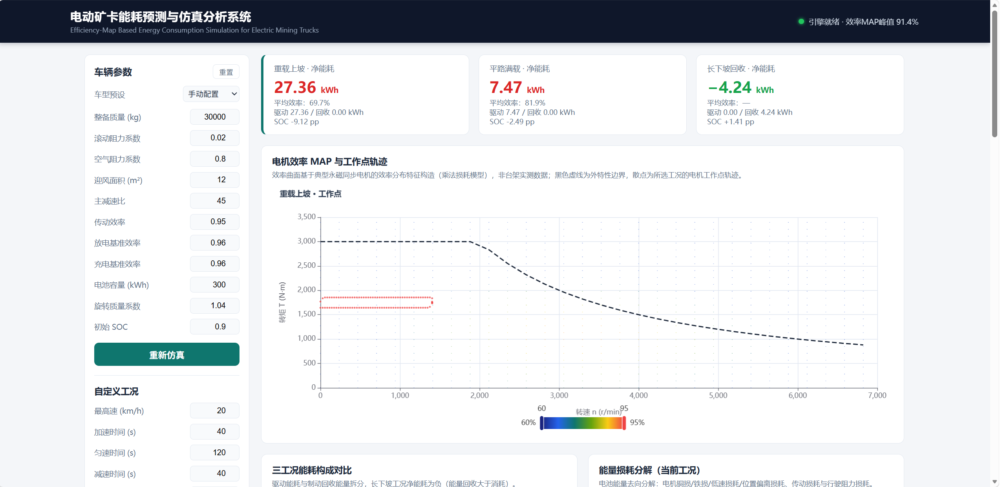

# 电动矿卡能耗预测与仿真分析系统

**Efficiency-Map Based Energy Consumption Simulation for Electric Mining Trucks**

一个面向 60 吨级电动矿卡的能耗预测与仿真分析平台：基于电机效率 MAP 查表与纵向动力学耦合模型，对典型矿山工况逐秒求解能耗，并提供效率 Map 可视化、能量损耗分解、参数敏感性分析与交互式仿真。

算法核心完整移植自毕业设计的 MATLAB 仿真程序，并经过**逐点一致性对账**（浮点精度内一致，见 [验证](#验证)）。

在此之上，`ml/` 目录进一步实现了以该机理模型为教师的数据驱动代理模型对比实验（见 [数据驱动代理模型](#数据驱动代理模型ml)）。


---



---

## 特性

- **效率-动力学耦合仿真引擎**：纵向动力学平衡 → 电机效率 MAP 查表（含高速弱磁/低速/过载五类边界处理）→ C-rate 相关电池效率 → 梯形积分累积能耗，全程向量化，一次工况仿真毫秒级完成
- **SOC 状态跟踪**：电池端能量积分得到 SOC 时程曲线，支持能量回收工况下 SOC 回升的刻画
- **交互式参数面板**：修改整备质量、传动比、阻力系数等 10 项车辆参数 + 初始 SOC，一键重算并联动刷新全部图表；内置 60/90/110 吨级车型预设
- **自定义工况编辑器**：梯形速度曲线（加速-匀速-减速）+ 坡度 + 载重参数化生成任意工况，一键仿真并接入全部联动视图
- **多车型对比**：同工况下 60/90/110 吨级车型的净能耗与回收能量横向对比
- **七类可视化**：效率 MAP 热力图叠加工作点轨迹、三工况能耗构成对比、效率/功率/能耗/SOC 时程曲线、能量损耗分解环形图、参数敏感性 Tornado 图、多车型能耗对比、效率模型对比
- **能量损耗分解**：将电池能量去向分解为电机铜损、铁损、低速损耗、位置偏离损耗、传动损耗与行驶阻力损耗（串联级联法）
- **参数敏感性分析**：对载重、滚动阻力、传动效率、主减速比做 ±20% 单因素摄动，量化各参数对能耗的影响权重
- **效率模型对比**：在相同工况下对比效率 MAP 与恒定效率（默认 90%）假设，量化简化效率模型带来的能耗偏差
- **数据自包含**：效率 MAP 与工况数据均由程序生成，无需 MATLAB 及原始数据文件，clone 即用

## 架构

```
┌──────────────────────────────────────────────────────┐
│  Frontend (纯静态, ECharts 5)                        │
│  参数面板 · 效率Map热力图 · 能耗对比 · 时程 · Tornado  │
└────────────────────────┬─────────────────────────────┘
                         │ REST API (JSON)
┌────────────────────────▼─────────────────────────────┐
│  FastAPI 后端                                        │
│  /api/simulate  /api/sensitivity  /api/decompose     │
│  /api/motor-map /api/cycles /api/meta                │
│  /api/compare  /api/compare-efficiency               │
└────────────────────────┬─────────────────────────────┘
                         │
┌────────────────────────▼─────────────────────────────┐
│  仿真引擎 core/                                      │
│  vehicle.py     纵向动力学（滚动/空气/坡度/加速阻力） │
│  efficiency.py  电机效率MAP查表（5类边界处理）        │
│  battery.py     C-rate相关电池充放电效率              │
│  simulation.py  逐秒能耗积分仿真（向量化）            │
│  map_generator.py  乘法损耗模型效率曲面生成           │
│  decomposition.py  能量损耗分解（串联级联）           │
│  sensitivity.py  单因素摄动敏感性分析                │
│  cycles.py      典型矿山工况 + 自定义工况构造         │
│  comparison.py  效率 MAP 与恒定效率模型对比           │
└──────────────────────────────────────────────────────┘
```

## 算法模型

### 纵向动力学

$$F_{total} = \underbrace{m g f_r \cos\alpha}_{滚动阻力} + \underbrace{\tfrac{1}{2}\rho C_d A v^2}_{空气阻力} + \underbrace{m g \sin\alpha}_{坡度阻力} + \underbrace{\delta m a}_{加速阻力}$$

轮边需求功率 $P_{wheel} = F_{total} \cdot v$，电机转速 $n = \dfrac{v \cdot i_{total} \cdot 60}{2\pi r_w}$。

### 电机效率 MAP（乘法损耗模型）

$$\eta = \eta_{peak} \cdot f_n(n) \cdot f_T(T) \cdot (1-\delta_{cu}) \cdot (1-\delta_{fe}) \cdot (1-\delta_{low})$$

其中 $f_n, f_T$ 为转速/转矩方向效率因子（不对称高斯），$\delta_{cu}$ 为铜损（与转矩平方成正比）、$\delta_{fe}$ 为铁损（高速显著）、$\delta_{low}$ 为低速附加损耗。模型峰值效率因子 93.5%（网格离散采样后实际峰值 91.4%），高效区（≥90%）平台约 2000–4000 r/min × 800–1600 N·m。

### 电池效率（C-rate 模型）

$$\eta_{dis} = 0.96 - 0.02 \cdot \min(C_{rate}, 3), \qquad \eta_{chg} = 0.96 - 0.03 \cdot \min(C_{rate}, 2)$$

## 快速开始

```bash
# 1. 安装依赖
pip install -r requirements.txt

# 2. 生成数据（首次运行；已提交的 data/ 可直接使用）
python scripts/prepare_data.py

# 3. 启动服务
uvicorn backend.app:app --reload

# 4. 浏览器打开
#    http://127.0.0.1:8000
```

运行测试：

```bash
python -m pytest tests/ -v
```

## API

| 方法 | 路径 | 说明 |
|------|------|------|
| GET | `/api/health` | 健康检查，返回 `{"status":"ok"}` |
| GET | `/api/meta` | 默认车辆参数、车型预设、工况列表、MAP 峰值 |
| GET | `/api/motor-map` | 效率 MAP 网格数据（可降采样） |
| GET | `/api/cycles` | 三工况时间序列 |
| POST | `/api/simulate` | 运行能耗仿真，body: `{params?, cycle_ids?, custom_cycle?}` |
| POST | `/api/sensitivity` | 参数敏感性分析 |
| POST | `/api/decompose` | 能量损耗分解（支持 cycle_id 或 custom_cycle） |
| POST | `/api/compare` | 多车型同工况能耗对比 |
| POST | `/api/compare-efficiency` | 效率 MAP 与恒定效率模型的能耗对比 |
| GET | `/docs` | 交互式 API 文档（FastAPI 自动生成） |

自定义工况仿真示例：

```bash
curl -X POST http://127.0.0.1:8000/api/simulate \
  -H "Content-Type: application/json" \
  -d '{"custom_cycle": {"v": [0, 5, 10, 10, 5, 0], "grade": [6, 6, 6, 6, 6, 6], "payload": [60000, 60000, 60000, 60000, 60000, 60000]}}'
```

## 验证

Python 移植版与 MATLAB 原始程序（毕设 `main_simulation04.m` 等）逐项对账，**全部在浮点精度内一致**：

| 项目 | 工况 | MATLAB 基准 | Python 移植 | 最大误差 |
|------|------|------------|------------|---------|
| 总能耗 E_total | 重载上坡 | 27361.5452 Wh | 27361.5452 Wh | < 1e-6 |
| 总能耗 E_total | 平路满载 | 7469.4328 Wh | 7469.4328 Wh | < 1e-6 |
| 总能耗 E_total | 长下坡回收 | -4238.7208 Wh | -4238.7208 Wh | < 1e-6 |
| 效率 MAP 曲面 | 全域 100×120 | — | — | 4.4e-16 |
| 逐点序列 n/T/η/P | 三工况 | — | — | ≤ 2.9e-10 |

对账脚本：`scripts/reconcile_matlab.py`（需原始 `.mat` 数据，仅作开发验证用）。

### 典型仿真结果（默认参数，60 吨级）

| 工况 | 净能耗 | 驱动能耗 | 回收能量 | 驱动段平均效率（功率加权） | SOC 变化 |
|------|--------|---------|---------|--------------------------|---------|
| 重载上坡（8%坡，满载60t） | 27.36 kWh | 27.36 kWh | 0 | 69.7% | -9.12 pp |
| 平路满载（20km/h） | 7.47 kWh | 7.47 kWh | 0 | 81.9% | -2.49 pp |
| 长下坡回收（-7%坡，空载） | -4.24 kWh | 0 | 4.24 kWh | — | +1.41 pp |

### 多车型对比（同工况）

| 车型 | 重载上坡 | 平路满载 | 长下坡回收 |
|------|---------|---------|-----------|
| 60 吨级（整备 30t / 300 kWh） | 27.36 kWh | 7.47 kWh | -4.24 kWh |
| 90 吨级（整备 42t / 420 kWh） | 33.14 kWh | 8.43 kWh | -6.19 kWh |
| 110 吨级（整备 52t / 520 kWh） | 36.30 kWh | 9.34 kWh | -7.82 kWh |

## 数据驱动代理模型（ml/）

在机理模型之上叠加一层数据驱动代理模型，回答一个工程问题：**能不能用一个快几个数量级的模型近似机理模型的结论，支撑车队调度、能量管理策略寻优中的大规模工况评估？**

做法：以效率 MAP 机理模型为**教师**（teacher），随机采样 6500 条矿山工况生成净能耗标注；构建 26 维物理统计特征（工况统计量 + 动力学派生量 + 整车参数），刻意不引入效率查表结果以规避标签泄漏；训练岭回归与两层 MLP 作为**代理**（surrogate）。

| 模型 | MAE (kWh) | RMSE | MAPE | R² |
|------|-----------|------|------|-----|
| 恒定效率 90%（物理假设参照系） | 1.749 | 3.285 | 16.13% | 0.9638 |
| 岭回归（线性代理） | 0.920 | 1.502 | 11.76% | 0.9924 |
| MLP 64-32（非线性代理） | **0.162** | **0.250** | **2.23%** | **0.9998** |

- **分工况误差**：平路 MAPE 3.03%、长下坡 2.61%、重载上坡 1.07%。MAPE 以净能耗为分母，上坡工况能耗量级大、相对误差被摊薄，因此分工况评价需同时看 MAE 与 MAPE，只看一个会得出相反结论
- **分布外泛化**：坡度（±18%）、载重（95 t）、车速（45 km/h）、传动效率（0.80~0.99）全面越界时，MLP 的 MAPE 由 2.23% 升至 10.68%（4.8×），据此划出代理模型的替代边界，工程上采「粗筛 + 精算」两段式流程
- **推理加速**：单次评估由 0.15 ms 降至微秒级，提升两个数量级以上

运行：

```bash
python -m ml.train_eval
```

约 30 秒完成，输出 `ml/report.md`（完整实验报告，含分布外测试、置换特征重要性、badcase 分析与速度基准）、`ml/metrics.json` 与 `ml/test_predictions.csv`。

**方法边界**：标签由机理模型生成，因此这是代理建模（surrogate modeling），目标是逼近机理模型的结论，而非预测实车能耗；要跳到真实预测需引入实测数据做参数标定。

## 项目结构

```
mine-truck-energy-sim/
├── backend/
│   ├── app.py                # FastAPI 入口与路由
│   └── core/                 # 仿真引擎核心算法
│       ├── vehicle.py        # 车辆动力学 + 车型预设
│       ├── efficiency.py     # 效率MAP查表
│       ├── battery.py        # 电池效率模型
│       ├── simulation.py     # 能耗仿真引擎（含 SOC 跟踪）
│       ├── map_generator.py  # 效率曲面生成
│       ├── decomposition.py  # 能量分解
│       ├── comparison.py     # 效率 MAP 与恒定效率模型对比
│       ├── sensitivity.py    # 敏感性分析
│       └── cycles.py         # 典型矿山工况 + 自定义工况构造
├── frontend/                 # 纯静态前端（ECharts 5）
│   ├── index.html
│   ├── css/style.css
│   └── js/app.js
├── docs/                     # 截图等文档素材
├── data/                     # 程序生成的数据（已提交）
├── tests/                    # 单元测试与 API 集成测试（37 项）
├── scripts/                  # 数据准备 / 对账 / 冒烟测试
├── ml/                       # 数据驱动代理模型实验
│   ├── data.py               # 工况采样 + 26 维特征工程 + 数据集构建
│   ├── models.py             # 纯 numpy 岭回归与 MLP（Adam）
│   ├── train_eval.py         # 训练、评测、报告生成
│   ├── report.md             # 自动生成的对比实验报告
│   └── README.md             # 方法与结论摘要
├── requirements.txt
└── LICENSE
```

## 背景

本项目源于本科毕业设计《电动矿卡能耗预测》的工程化重构：将 MATLAB 仿真程序完整移植为 Python 工程，补齐数据自包含、可视化与交互能力，并建立与 MATLAB 基准的一致性对账体系。后续在机理模型之上加入数据驱动代理模型实验，用于探讨机器学习模型在多大范围内可以替代机理模型做快速工况评估。适用于新能源矿用车整车能耗仿真、动力系统匹配与运营节能分析等场景。

## License

[MIT](LICENSE)
